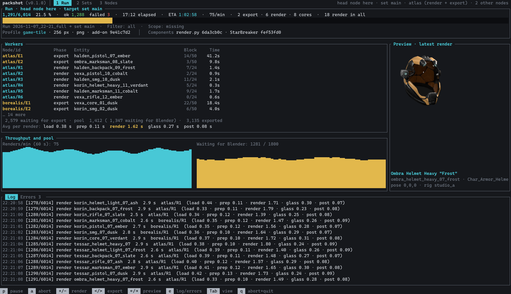
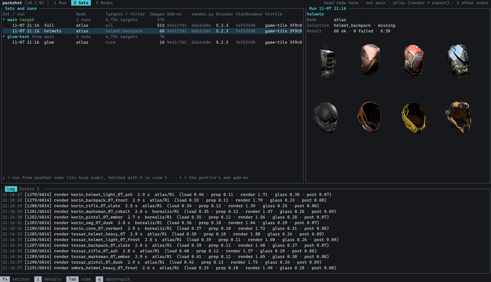
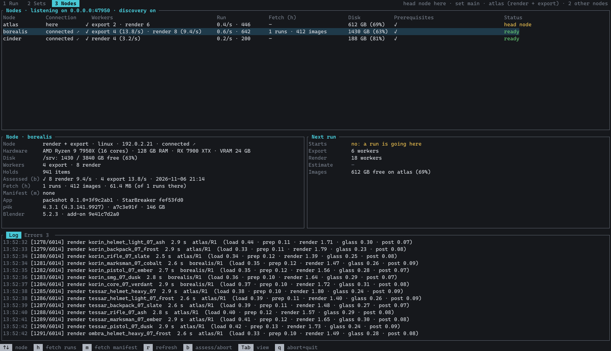
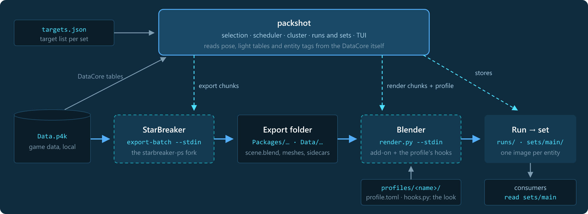

<p align="center"></p>

<h1 align="center">packshot</h1>

<p align="center">
  <a href="https://github.com/w00zla/sc-packshot/actions/workflows/test.yml"></a>
  <a href="https://github.com/w00zla/sc-packshot/releases"></a>
  <a href="LICENSE"></a>
  <a href="Cargo.toml"></a>
  
</p>

<p align="center">
  Renders of Star Citizen entities, in bulk: packshot exports each entity from the game's <code>Data.p4k</code> with
  <a href="https://github.com/w00zla/starbreaker-ps">starbreaker-ps</a> (a StarBreaker fork) and renders it in Blender,
  many exports and Blender processes at once, on one PC or a cluster of nodes, driven from a terminal UI. It started as
  the icon renderer of the Quartermaster org tool and is meant for anyone who wants pictures of the game's items, in
  their own look.
</p>

<p align="center"><a href="docs/assets/tui-run.png"></a><br><sub>click for full size</sub></p>

- **Bulk:** thousands of entities per run; long-lived exporter and Blender processes, fed one job per line.
- **One PC or a cluster:** nodes find each other on the LAN, any node can start a run, files move by content hash.
- **The game's own staging:** pose and light rig per item type (and tag) from the game's inventory data.
- **Your own look:** a profile (parameters plus four Python hooks) decides materials, scene and output: PNG, JPEG, EXR.
- **Runs and sets:** every run is kept as it was; sets pick the newest image per entity, experiments branch off.
- **Measured, not guessed:** an assessment finds how many processes a node carries; `--report` reads a run's log.

## Requirements

- Windows 10/11 or Linux, a GPU with Vulkan (rendering).
- For exporting and the target picker: the game's `Data.p4k` with its `build_manifest.id` next to it.
- Internet once for the setup (it fetches Blender), or Blender's official archive put next to the bundle.
- To build from source: Rust 1.89+ and git.

## Use

Download the bundle for your OS from the [releases](https://github.com/w00zla/sc-packshot/releases) and unpack it
anywhere. It brings packshot, StarBreaker with its Blender add-on, `render.py` and the bundled profiles; the setup adds
Blender (from blender.org, or the official archive you put next to it).

```bat
setup.cmd                     :: Blender and the add-on (Linux: bash setup.sh)
check.cmd                     :: the add-on loads, Eevee renders on Vulkan (Linux: bash check.sh)
run.cmd --render --export     :: the TUI; --help lists everything (Linux: ./run.sh)
```

On Linux run the check first: a headless Blender depends on the GPU driver and its Vulkan setup.

- `--render` lets the node run Blender, `--export` StarBreaker (it needs `Data.p4k`); with neither it only starts,
  stores and watches runs.
- The TUI always opens: a **Start** tile in the Run view shows what is missing and what to do, and turns off only what
  needs it.
- Starting a run asks for its name and **profile**, the look (default `game-tile`, the game's inventory tiles;
  [Profiles](#profiles)), and for a target list while the set has none (a JSON file or the target picker;
  [Target lists](#target-lists)). `--profile` preselects the profile; `--size` and `--format png|jpeg|exr` override
  its values.
- **Cluster:** the same `token` in every node's `packshot.json` (copied from `packshot.example.json`), port 47950 TCP
  and UDP open on the LAN, nodes on another subnet in `peers`.
- Process counts follow the node's measured **assessment** (`--assess` or `b`), else a share of its cores.

## The terminal UI

Three views, switched with `1` `2` `3` or `Tab`; the last line always lists the keys that work right now. Images show
in full on terminals with Sixel, Kitty or iTerm2 graphics, else as half blocks (`PACKSHOT_GRAPHICS` forces one).

### Run

The selection to render (head node, target set, filter, scope), or the run going on: progress and ETA, every worker on
every node with the entity it is on, throughput and the pool of exported items waiting for a Blender, the latest
render. The image above shows a run on three nodes.

| Key | |
|---|---|
| `n` · `s` | head node · target set for the next run |
| `/` · `x` · `u` | filter · clear it · scope (missing, failed, all) |
| `Enter` | start a run: asks for its name and profile |
| `+` `-` · `<` `>` | more or fewer Blender · export processes on this node |
| `p` · `a` | pause · abort the run |
| `←` `→` | browse the latest renders |
| `e` | log or errors |

### Sets

<p align="center"><a href="docs/assets/tui-sets.png"></a><br><sub>click for full size</sub></p>

The sets with their runs, newest first, with the add-on, `render.py`, StarBreaker and profile each run used (a `*`
after the add-on marks the profile's own add-on copy). On the right the selected set's tile, or the selected run's: node,
selection, result, profile (where it came from, its hash), the core (`render.py`'s hash), size and format and where they
came from, add-on, template, StarBreaker, Blender, `Data.p4k` and workers, with some of its images below.

| Key | |
|---|---|
| `Enter` | make the selected set the target set |
| `n` · `t` | new set (branches off `main`) · its target list (a file, or the target picker) |
| `l` | adopt an experiment into `main` |
| `x` | delete a run or a set |

### Nodes

<p align="center"><a href="docs/assets/tui-nodes.png"></a><br><sub>click for full size</sub></p>

Every node with its workers and assessed speed, its share of the run, runs to fetch, free disk and whether its state
matches; below the selected node's details and where and how the next run would start.

| Key | |
|---|---|
| `b` | assess the selected node (again: abort) |
| `h` | fetch the selected node's runs that are missing here |
| `m` | fetch its `main` manifest, so "missing" counts what it has (on this node: drop it) |
| `r` | ask the node for its state again |

## How it works

<p align="center"><a href="docs/assets/arch-overview.png"></a></p>

packshot renders nothing itself. It cuts the selected targets into chunks and hands them to long-lived processes:

| Stage | Process | Result |
|---|---|---|
| Export | `starbreaker entity export-batch --stdin`, one per export slot | a decomposed package per entity: `scene.blend`, meshes, PNG textures, material sidecars |
| Render | `blender -b --python render.py -- --stdin`, one per render slot | the add-on builds the materials, the profile stages and renders one image per entity |
| Store | packshot | the image in the run's folder, hard-linked into the target set |

Between the stages every exported item waits in the **pool**, held on the node that exported it; a render chunk may
take items from any holder and fetches their files from there. Chunks shrink towards the end of a run, so all
processes finish together. The details (material sidecars, modules, an item's way through a run, scheduler, cluster,
processes, state check, assessment): [docs/ARCHITECTURE.md](docs/ARCHITECTURE.md).

### StarBreaker

Export and materials come from [starbreaker-ps](https://github.com/w00zla/starbreaker-ps), a fork of
[StarBreaker](https://github.com/diogotr7/StarBreaker) made for packshot:

| Part | What packshot gets |
|---|---|
| `entity export-batch --stdin` | a long-lived exporter: loads `Data.p4k` and the DataCore once, then exports one entity per stdin line; a job that fails or panics is answered as a failure and the process goes on |
| `dcb query --ids` | the entity list for the target picker (record id, class name, item type and subtype) and the entities' tags, each in about a second |
| Blender add-on | builds Blender's material node trees from the package's sidecars: layer blends, tint palettes, decals, glass, glow |

Both come from the fork's release `deps.toml` pins: the setup and the bundle scripts download its files and check
their SHA256.

### Blender

Every render slot runs one portable Blender of the version `deps.toml` pins (5.2.3; config and add-on in its
`portable/` folder, nothing in the user profile), downloaded from blender.org and checked against the pinned SHA256.

| | |
|---|---|
| Renderer | Eevee on the **Vulkan** backend, 16 samples, transparent film, 256 px PNG (`game-tile`; `--size`, `--format`) |
| Staging | pose and light rig from the game's inventory data (per item type; an entry for a tag the entity carries wins, e.g. the sidearms rig for pistols), the item scaled to 0.7 m |
| Look | (`game-tile`) linear EXR mapped by its own tone curve, a studio world, boosted emission with bloom, a second pass for light behind glass |

### Runs and sets

| | |
|---|---|
| **Run** | `runs/<date>_<time>_<name>/`: the images as `<Name> (<class>) <uuid>.<png\|jpg\|exr>`, `run.json` (with the profile, its hash, size and format), `events.jsonl`, `run.log`; never changed after its end |
| **Set** | `sets/<name>/`: per entity a hard link to the newest image in its chain of runs, whatever its format, plus its own `targets.json` |
| **main** | the set consumers read; an experiment set branches off it and is adopted by appending its runs |

Everything packshot writes lives in one folder, laid out the same on every node: `local/packshot/` in a checkout, the
bundle's own folder in a bundle (`--store`, `--work`). `packshot --report` evaluates a run's event log: throughput,
phase timings, slot use per node, slowest entities.

### Target lists

A target list says which entities a run renders; every set keeps its own copy. The lists live in `targets/` of the
packshot folder (subfolders are fine); `t` in the Sets view lists every list there, `targets/targets.json` first, and
offers the target picker.

The **target picker** ("From the DataCore …") builds one from the game's entities: a search field (class names with
`*`, display names, types; terms are or'ed), a tree of item types and subtypes with counts to tick, and the result
next to them. Ticked types (none ticked: all) narrowed by the search make the list; several exact class names pasted
into the search make exactly that list, e.g. a fixed sample to compare builds. In the type tree `+` ticks every type
shown and `-` clears all ticks. `Enter` asks for a name and writes the list as `targets/<name>.json` (letters, digits,
`-`, `_`, `.`; the dialog offers it again) and takes it as the set's list; `Esc` cancels the picker. The entity list
behind it is read once per game build (a few seconds) and cached in the work folder.

The file is a JSON array, one object per entity; other tools can write it, packshot reads only these fields:

| Field | |
|---|---|
| `uuids` | one or more ids; the first names the image file, further ones become hard links to it |
| `names` | optional, one display name per id (shown in the TUI and the image file name) |
| `entity` | the entity's class name in the DataCore (`behr_rifle_ballistic_01`) |
| `type` · `subType` | the item type and subtype (`WeaponPersonal` · `Medium`); with the entity's tags (read from the DataCore) they pick pose and light rig |
| `worn` | optional, `true` renders armour and clothing worn instead of as their loot crate |

```json
[{ "uuids": ["02d4cd2e-fa98-4086-aee1-6b2dfce8ea27"], "names": ["P4-AR Rifle"], "entity": "behr_rifle_ballistic_01",
   "type": "WeaponPersonal", "subType": "Medium", "worn": false }]
```

### Cluster

Every node starts with what it can do now (`--render`, `--export`, both or neither). Any node can start a run, on
itself or on another node, which then holds it as the **head node** and assigns the chunks. One run at a time in the
cluster. Every node must run the same packshot build, Blender, add-on and StarBreaker, and the exporting nodes the same
`Data.p4k`; otherwise no run starts and the TUI shows what differs. The starter decides what a run renders, as on one
node: target set, target list and profile go along to the head node. The head node sends `render.py`, `game-tile` and
the run's profile with every render chunk; a node keeps them while it runs.

## Profiles

A profile is a folder with two files. Anything it does not set falls back to `game-tile`, the default profile:

| File | |
|---|---|
| `profile.toml` | `[params]`: `size` (px), `samples`, `format` (`png` · `jpeg` · `exr`), `quality` and `background` (JPEG), `fit`, `margin`, `light_scale`. Optional `scene = "<file>.blend"`, a template whose world, cameras and lights the `stage` hook may take; optional `addon = "starbreaker_addon"`, the profile's own copy of the add-on, used instead of the installed one |
| `hooks.py` | up to four functions, each taking one context `ctx` (`job`, `params`, `scene`, paths, `use_template()`) |

`render.py` calls the hooks in this order for every item; a hook the profile does not define runs `game-tile`'s:

| Hook | When | `game-tile` does |
|---|---|---|
| `before_open(ctx)` | before the item's file opens | nothing (the place to set add-on constants or replace its methods) |
| `after_open(ctx)` | after the add-on built the materials | sharper gloss on metal and glass, stronger emission, hides empty UI screens |
| `stage(ctx)` | then | the game's pose, the camera fit, the game's light rig, a studio world, Eevee settings |
| `post(ctx, exr_paths)` | after the render, a linear multi-layer EXR | bloom, contrast, tone curve, a second pass for glow behind glass; writes the image, returns its path |

Parameters stack: `game-tile`'s, then the profile's, then `--size` / `--format`. Formats: `png` is sRGB with
transparency; `jpeg` the same over `background`; `exr` is linear with the bloom but no tone curve, for your own grading.

A profile that renders large JPEGs on white needs only a `profile.toml`:

```toml
[params]
size = 1024
format = "jpeg"
background = [1.0, 1.0, 1.0]
```

Bundled profiles live in `profiles/` next to the tool; your own go into `profiles/` of the packshot folder (in a bundle
that is the bundle's own `profiles/`) and hide a bundled one of the same name; `game-tile` itself cannot be replaced.
Every run records its profile, the profile's content hash and the size and format used; the Sets view shows the
profile per run, the run's tile all of it.

## Develop

| Path | What |
|---|---|
| `src/` | the orchestrator (Rust): selection, scheduler, cluster, runs and sets, assessment, TUI |
| `blender/render.py` | runs inside Blender: opens the item, calls the profile's hooks, renders a linear EXR for its `post` hook |
| `profiles/` | the bundled profiles: `game-tile` (pose, fit, light rig, material tweaks, tone curve; PNG, JPEG or EXR) |
| `shim/` | RDSEED shim for Blender on Linux (built by `build.rs`, embedded in the binary) |
| `templates/bundle/` | templates of the per-OS bundles (setup, check, run, README, cluster config) |
| `deps.toml` | the pins: Blender version and archive SHA256s, the StarBreaker release with its SHA256s and commit |
| `scripts/` | `setup.{ps1,sh}` (a dev checkout), `starbreaker-build.{ps1,sh}` (the fork), `packshot-bundle.{ps1,sh}` (the bundles) |
| `docs/` | [`ARCHITECTURE.md`](docs/ARCHITECTURE.md), `assets/` (images and their sources) |

One script sets up a checkout exactly as `deps.toml` pins it, and the bundles are built from the same pins:

```powershell
scripts/setup.ps1                              # Blender, add-on and StarBreaker from the pinned release (Linux: scripts/setup.sh)
scripts/setup.ps1 -FromSource                  # the same with the fork next to the repo: add-on linked into it, StarBreaker built (Linux: --from-source)
cargo run --release -- --render --export       # store in local/packshot/, Blender in local/blender/
cargo test --release                           # real-tool tests are #[ignore] and need SC_DATA_P4K
scripts/packshot-bundle.ps1                    # both bundles into local/packshot-bundle/ (Linux: scripts/packshot-bundle.sh)
```

To move to another Blender or StarBreaker: change `deps.toml`, run the setup again, rebuild the bundles. Building the
fork itself (`-FromSource`, `scripts/starbreaker-build.*`) needs zig and cargo-zigbuild for its Linux binary. Changes
land on `main` through pull requests.

## Security

In a cluster every rendering node runs Python it receives: `render.py` from the head node, the profile's `hooks.py` and
any add-on copy from the node that starts the run. Anyone with the token can make every node run code, so share a
cluster only with machines and people you trust.

## Game data and fan content

This repository contains no game data; packshot reads your own copy of the game.

packshot is an unofficial Star Citizen fan project, not endorsed by or affiliated with the Cloud Imperium group of
companies. Game content and materials, including everything packshot renders, are copyright Cloud Imperium Rights LLC
and Cloud Imperium Rights Ltd. Star Citizen® is a registered trademark of Cloud Imperium Rights LLC.

## Credits

[StarBreaker](https://github.com/diogotr7/StarBreaker) by Diogo Trindade and the
[fleetyards fork](https://github.com/fleetyards/StarBreaker) it builds on; [Blender](https://www.blender.org/).

## License

MIT, see [LICENSE](LICENSE).
