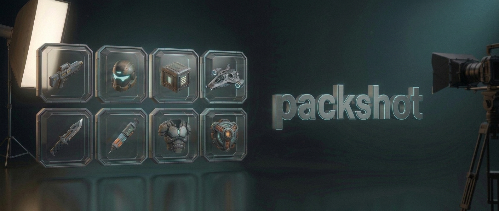
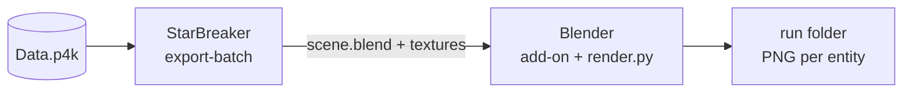

<p align="center">
  
</p>

<h1 align="center">packshot</h1>

<p align="center">
  <b>Utility for 3D renders of Star Citizen entities, flexible in material shaders and posing/lighting.</b><br>
  Export "every" entity straight from the game files and render it in Blender! Also supports bulk rendering and network distribution of workloads.
</p>

<p align="center">
  
  
  
  
</p>

---

## What it does

- **Exports entities from `Data.p4k`** with a modified version of [StarBreaker](https://github.com/w00zla/starbreaker-ps): meshes, textures,
  materials, paints and palettes.
- **Renders them in Blender** with the staging and materials you choose: orientation, framing, light rig, scene and
  material tweaks come from a profile. The default profile mimics the game's inventory tiles. (Profiles are in
  progress, see [ADR 0022](docs/adr/0022-modular-profiles.md); today only the default look exists.)
- **Terminal UI** CLI app for managing renders, with support for multiple render-nodes, live progress, throughput, node status and render preview.

## How it works



### StarBreaker fork

Export and materials come from **[starbreaker-ps](https://github.com/w00zla/starbreaker-ps)**, a fork of
[StarBreaker](https://github.com/diogotr7/StarBreaker) made for packshot: its `entity export-batch --stdin` exporter
feeds the export workers, and its Blender add-on builds the materials. packshot uses it as a pinned build
([ADR 0026](docs/adr/0026-starbreaker-by-release-pin.md)); the fork's own decisions are in its
[docs/adr](https://github.com/w00zla/starbreaker-ps/tree/main/docs/adr).

## Quick start

Grab a bundle for your OS (built with `scripts/packshot-bundle.sh` or `.ps1`). It contains packshot, StarBreaker,
Blender and the render script.

```sh
bash setup.sh          # unpacks Blender (Windows: setup.cmd)
bash check.sh          # add-on loads, EEVEE renders on Vulkan
./run.sh --render --export
```

- `--render` lets this machine render, `--export` lets it export. Export needs the game's `Data.p4k` and
  `build_manifest.id` next to the bundle, or `--p4k <path>`.
- Use both flags, one of them, or neither: with neither, the node only starts and watches runs.
- `--help` lists everything else.

### In the TUI

| Key | |
|---|---|
| `1` `2` `3` / `Tab` | views: **Run**, **Sets**, **Nodes** |
| `Enter` | start a run |
| `/` | filter targets |
| `+` `-` · `<` `>` | more or fewer Blender · export processes |
| `b` | measure this node (assessment) |
| `e` | log / errors |

### Cluster

1. Copy `packshot.example.json` to `packshot.json` on every node.
2. Set the same `token` in each.
3. Open port 47950 (TCP and UDP) on the LAN.

Nodes on another subnet go into `peers`. All nodes need the same packshot, Blender, add-on and StarBreaker versions.

## Output

```
runs/2026-11-05_14-30_<name>/   one folder per run: images, run.json, events.jsonl, run.log
sets/live/                      the current image of every entity (hard links into runs)
sets/<experiment>/              a branch of live, adopted into live when you like it
```

`packshot --report` shows a run's numbers: throughput, phase timings and the slowest entities.

## Status and roadmap

packshot was just split out of the project it was built for. It runs as it did there, and its layout
(`tools/packshot/`, `src/icons/render.py`, `scripts/`) still shows that.

Next is the **modular design** ([ADR 0022](docs/adr/0022-modular-profiles.md)): profiles that combine these freely,
so the main use becomes playing with looks.
- target selection
- exporter
- materials: your own add-on or an override script
- photo scene: a `.blend` you edit in Blender
- output format

Today's look becomes the default profile.

## Documentation

- [Pipeline](docs/pipeline.md): export, look, scheduler, runs and sets, cluster, assessment, bundles.
- [Architecture decisions](docs/adr/README.md): why things are the way they are.
- [CLAUDE.md](CLAUDE.md): working rules for contributors and coding agents.

## Building

```sh
cd tools/packshot
cargo build --release
cargo test --release
```

## Security

In a cluster, every node runs Python (render script, add-on) that it receives from the node that starts a run. Anyone
with the token can make every node run code, so share a cluster only with machines and people you trust
([ADR 0028](docs/adr/0028-security-notice-only.md)).

## Game data

This repository contains no game data; you need your own copy of Star Citizen. Rendered entities are the intellectual
property of Cloud Imperium Games. packshot is a fan project, not affiliated with or endorsed by Cloud Imperium Games.

## Credits

- [StarBreaker](https://github.com/diogotr7/StarBreaker) by Diogo Trindade.
- The [fleetyards fork](https://github.com/fleetyards/StarBreaker) it builds on.
- [starbreaker-ps](https://github.com/w00zla/starbreaker-ps), the fork packshot uses.
- [Blender](https://www.blender.org/).

## Licence

MIT, see [LICENSE](LICENSE).
