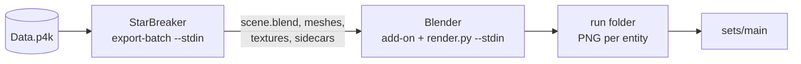

<p align="center"></p>

# packshot

Renders of Star Citizen entities, in bulk: packshot exports each entity from the game's `Data.p4k` with
[starbreaker-ps](https://github.com/w00zla/starbreaker-ps) (a StarBreaker fork) and renders it in Blender, many
exports and Blender processes at once, on one PC or a cluster of nodes, driven from a terminal UI. It started as the
icon renderer of the Quartermaster org tool and is meant for anyone who wants pictures of the game's items, in their
own look.

> Status: runs as it did inside Quartermaster, with one look (the game's inventory tiles). Next is the modular design:
> profiles that make materials and the photo scene replaceable ([ADR 0022](docs/adr/0022-modular-profiles.md)).
> Decisions and the plan: [`docs/adr/`](docs/adr/README.md).

## Layout

| Path | What |
|---|---|
| `src/` | the orchestrator (Rust): selection, scheduler, cluster, runs and sets, assessment, TUI |
| `blender/render.py` | runs inside Blender: pose, fit, light rig, material tweaks, Eevee render, tone curve, PNG |
| `shim/` | RDSEED shim for Blender on Linux (built by `build.rs`, embedded in the binary) |
| `bundle/` | templates of the per-OS bundles (setup, check, run, README, cluster config) |
| `deps.toml` | the pins: Blender version and archive SHA256s, the StarBreaker fork's commit |
| `scripts/` | `setup.{ps1,sh}` (a dev checkout), `starbreaker-build.{ps1,sh}` (the fork), `packshot-bundle.{ps1,sh}` (the bundles) |
| `docs/` | [`pipeline.md`](docs/pipeline.md) (how everything works, with measurements), `adr/` (decisions) |

## How it works



packshot renders nothing itself. It cuts the selected targets into chunks and hands them to long-lived processes:

| Stage | Process | Result |
|---|---|---|
| Export | `starbreaker entity export-batch --stdin`, one per export slot | a decomposed package per entity: `scene.blend`, meshes, PNG textures, material sidecars |
| Render | `blender -b --python render.py -- --stdin`, one per render slot | the add-on builds the materials, `render.py` stages and renders one PNG per entity |
| Store | packshot | the PNG in the run's folder, hard-linked into the target set |

Between the stages every exported item waits in the **pool**, held on the node that exported it; a render chunk may
take items from any holder and fetches their files from there. Chunks are cut when a process frees up and shrink
towards the end of a run, so all processes finish together. Pose and light rig come from the game's own inventory
data, read from the DataCore by packshot itself. No database, no Node.js: the target list is a file.

## StarBreaker

Export and materials come from [starbreaker-ps](https://github.com/w00zla/starbreaker-ps), a fork of
[StarBreaker](https://github.com/diogotr7/StarBreaker) made for packshot (its decisions:
[docs/adr](https://github.com/w00zla/starbreaker-ps/tree/main/docs/adr)). packshot uses two parts of it:

| Part | What packshot gets |
|---|---|
| `entity export-batch --stdin` | a long-lived exporter: loads `Data.p4k` and the DataCore once, then exports one entity per stdin line into a decomposed package; a job that fails or panics is answered as a failure and the process goes on |
| Blender add-on | builds Blender's material node trees from the package's sidecars: layer blends, tint palettes, decals, glass, glow |

Both come from the commit `deps.toml` pins; the build stamps each binary with it and the bundles refuse any other.
Later the pin becomes a tagged release of the fork ([ADR 0026](docs/adr/0026-starbreaker-by-release-pin.md)).

## Blender

Every render slot runs one portable **Blender** of the version `deps.toml` pins (5.2.3; config and add-on in its
`portable/` folder, nothing in the user profile), started headless with `blender/render.py` and fed one job per stdin
line. The setup and the bundle scripts download the official archive and check it against the pinned SHA256.

| | |
|---|---|
| Renderer | Eevee on the **Vulkan** backend, 16 samples, transparent film, 256 px (`--size`) |
| Staging | pose and light rig from the game's inventory data (per item type), the item scaled to 0.7 m |
| Look | linear EXR mapped by `render.py`'s own tone curve, a studio world, boosted emission with bloom, a second pass for light behind glass ([ADR 0005](docs/adr/0005-own-tone-curve-and-studio-world.md)) |
| Process | `--threads 2` per Blender; restarted after 200 jobs or 3 GB; idle ones quit after 60 s |
| Linux | an embedded shim replaces `std::random_device` in Blender, which otherwise capped a whole PC at about 13 items/s ([ADR 0020](docs/adr/0020-rdseed-shim.md)) |
| Answer | `icon: <png>` with phase timings (load, prep, render, glass, post) or `failed: <png> <error>` |

How many Blenders a node carries depends on its CPU, GPU and VRAM; the assessment measures it (below).

## Cluster

Every node starts with what it can do now: `--render` (Blender), `--export` (Data.p4k and StarBreaker), both, or
neither. Any node can start a run, on itself or on another node, which then holds it as the **head node** (run
folder, set, event log) and assigns the chunks. Nodes find each other by UDP broadcast and connect to each other over
TCP; a renderer fetches an item's files straight from its holder by content hash, so equal textures cross the network
once per run. One run at a time in the cluster.

| Must match on every node | Exporting nodes also |
|---|---|
| packshot build, Blender version, add-on, StarBreaker commit | the same Data.p4k (size and `build_manifest.id`) |

Otherwise no run starts and the TUI shows what differs. `render.py` travels with each render chunk from the head node.

## Runs and sets

| | |
|---|---|
| **Run** | `runs/<date>_<time>_<name>/`: the images as `<Name> (<class>) <uuid>.png`, `run.json`, `events.jsonl`, `run.log`; never changed after its end |
| **Set** | `sets/<name>/`: per entity a hard link to the newest image in its chain of runs, plus its own `targets.json` |
| **main** | the set consumers read (called live before ADR 0035); an experiment set branches off it and is adopted by appending its runs |

`packshot --report` evaluates a run's event log: throughput, phase timings, slot use per node, slowest entities.

## Requirements

- Windows 10/11 or Linux, a GPU with Vulkan (rendering).
- For exporting: the game's `Data.p4k` with its `build_manifest.id` next to it.
- To build: Rust 1.89+ and git; for the Linux StarBreaker on Windows also zig and cargo-zigbuild. Blender and the
  StarBreaker fork come with the bundles, or from `scripts/setup.*` in a checkout.

## Use

Get a bundle for your OS (`scripts/packshot-bundle.sh` or `.ps1`); it carries packshot, StarBreaker, Blender and
`render.py`.

```sh
bash setup.sh                 # unpacks Blender (Windows: setup.cmd)
bash check.sh                 # the add-on loads, Eevee renders on Vulkan
./run.sh --render --export    # TUI; --help lists everything
```

| Key | |
|---|---|
| `1` `2` `3` / `Tab` | views: **Run**, **Sets**, **Nodes** |
| `Enter` | start a run |
| `/` | filter targets |
| `+` `-` · `<` `>` | more or fewer Blender · export processes |
| `b` | measure this node (assessment) |
| `e` | log / errors |

Cluster: copy `packshot.example.json` to `packshot.json` on every node, set the same `token`, open port 47950 (TCP and
UDP) on the LAN; nodes on another subnet go into `peers`. Process counts default to the node's measured
**assessment** (`--assess` or `b`), else to a share of its cores.

## Develop

One script sets up a checkout exactly as `deps.toml` pins it, and the bundles are built from the same pins
([ADR 0033](docs/adr/0033-one-pin-file-for-dev-and-bundles.md)):

```sh
scripts/setup.ps1                                      # Windows (.sh on Linux): fork next to the repo, Blender, add-on, StarBreaker
cargo run --release -- --render --export               # store in local/packshot/, Blender in local/blender/
cargo test --release                                   # real-tool tests are #[ignore] and need SC_DATA_P4K
scripts/starbreaker-build.ps1 -Platform all            # both StarBreaker binaries at the pin (-Commit HEAD to try a fork change)
scripts/packshot-bundle.ps1                            # both bundles into local/packshot-bundle/ (.sh on Linux)
```

To move to another Blender or StarBreaker: change `deps.toml`, run the setup again, rebuild the bundles.

## The packshot folder

Everything packshot writes lives in one folder, laid out the same on every node: `local/packshot/` in a checkout,
the bundle's own folder in a bundle (`--store`, `--work`). It holds `packshot.json` (cluster), `assessment.json`,
`targets.json`, `runs/`, `sets/` and `work/` (exports, fetched files with a size limit, DataCore tables).

## Security

In a cluster every node runs Python (render script, add-on) that it receives from the node that starts a run. Anyone
with the token can make every node run code, so share a cluster only with machines and people you trust
([ADR 0028](docs/adr/0028-security-notice-only.md)).

## Game data and fan content

This repository contains no game data; packshot reads your own copy of the game.

packshot is an unofficial Star Citizen fan project, not endorsed by or affiliated with the Cloud Imperium group of
companies. Game content and materials, including everything packshot renders, are copyright Cloud Imperium Rights LLC
and Cloud Imperium Rights Ltd. Star Citizen® is a registered trademark of Cloud Imperium Rights LLC.

## Credits

[StarBreaker](https://github.com/diogotr7/StarBreaker) by Diogo Trindade and the
[fleetyards fork](https://github.com/fleetyards/StarBreaker) it builds on; [Blender](https://www.blender.org/).

## License

MIT, see [LICENSE](LICENSE).
