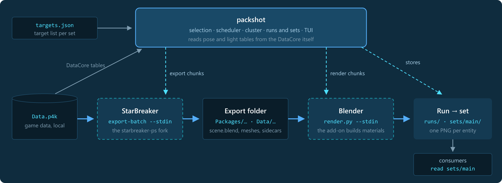
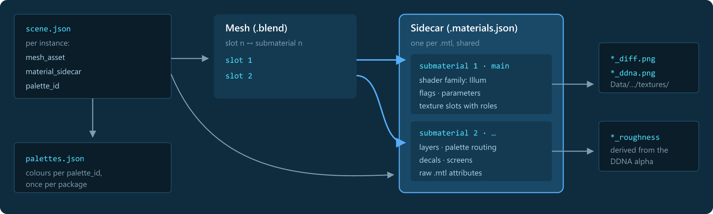
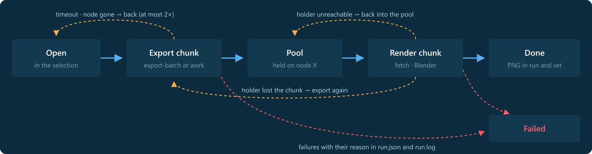
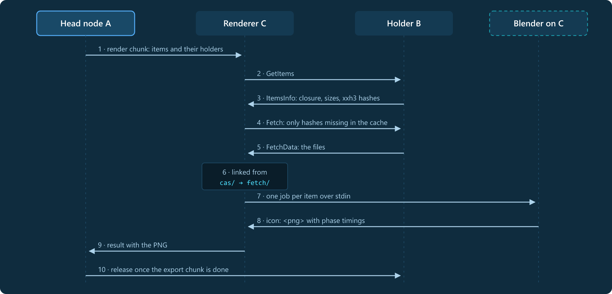
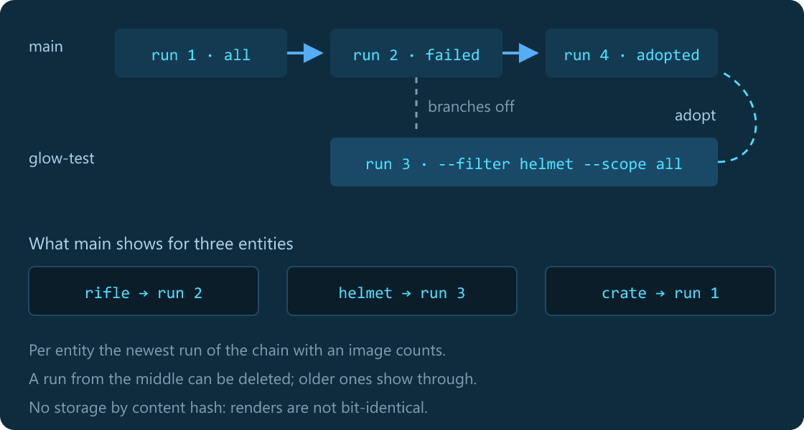

# Architecture

How packshot is built: the data flow, the material sidecars it moves around, its modules, the life of an item in a
run, the scheduler, the cluster, the processes, runs and sets, and the state check. The decisions behind it are in
[adr/](adr/README.md).

## One orchestrator, two worker processes



packshot renders nothing itself. It selects what to render, cuts the work into chunks, hands them to long-lived
**StarBreaker** and **Blender** processes and stores the images. Pose and light rig come from the game's DataCore,
read by packshot itself. No database: the target list is a file per set.

| Stage | What happens |
|---|---|
| Export | StarBreaker reads an entity from `Data.p4k` and writes a decomposed package: `scene.blend`, meshes, PNG textures and the material sidecars |
| Render | Blender loads the package; the StarBreaker add-on builds the node trees from the sidecars; `render.py` sets pose, fit and light rig, renders with Eevee and writes the PNG through its own tone curve |
| Store | the image goes into the run's folder, never changed afterwards, and as a hard link into the target set; consumers read `sets/main` |

## Material sidecars



In the game a CryEngine `.mtl` file describes a model's materials per **submaterial**: shader, feature flags,
textures, parameters. Blender cannot read it, and a mesh file carries only named material slots. So StarBreaker
translates every `.mtl` into a JSON **sidecar** (`<mtl>.materials.json`) next to meshes and textures:

- origin: the source `.mtl` and geometry paths
- per submaterial: name, shader and its family (`Illum`, `HardSurface`, `LayerBlend_V2`, …), whether it is drawn
- the `StringGenMask` feature flags, decoded (decals, POM, vertex colours, stencil, iridescence)
- texture slots with their role (base colour, normal-gloss, blend mask, …), game path and exported PNG
- layers of layered materials with their own textures, tiling and palette channel; parameters; screen effects
- the raw `.mtl` attributes, kept for diagnosis and for rules not written yet

The add-on matches each mesh slot to the submaterial of the same index, picks a builder by shader family (hard
surface, Illum, glass, screens, effects, POM decals, else a principled material), wires the textures by role and the
palette colours by the submaterial's routing. It builds an equal material once: identity is the sidecar content plus
the palette, not the file name. One sidecar serves every mesh of its `.mtl`; paint variants get their own exterior
sidecar (`paints.json`).

packshot reads sidecars for one thing: an item's **closure**, the files a renderer must fetch. The sidecars name the
textures, and since sidecars and textures are shared between items, they cross the network once per run.

## Modules

Everything runs on the main thread: the engine ticks, the TUI draws its state, the processes answer in stdout lines.
Only network reads and process output have threads of their own, which hand over messages.

| Module | Role |
|---|---|
| `main.rs` | arguments, checkout or bundle, paths, the locks on store and work folder; modes TUI, `--plain`, `--serve`, `--dry-run`, `--report`, `--assess` |
| `ui.rs` | the terminal UI (ratatui): views Run, Sets, Nodes, dialogs, log, image preview (Sixel, Kitty, iTerm2, else half blocks); reads the engine, sends only actions |
| `engine.rs` | a run: selection by filter and scope, chunks, pool, assignment, backlog, timeouts and requeues, results into run and set |
| `cluster.rs` | the engine's multi-node part: capabilities instead of roles, head node, state check, status every second, runs and manifests from other nodes |
| `node.rs` | the work on every node, the head node too: export chunks exported and held, render chunks fetched, linked and fed to Blender |
| `assess.rs` | the compute assessment: test set, render ladder, export sweep, CPU/GPU/VRAM/RAM sampling, `assessment.json` |
| `store.rs` | runs as immutable folders, sets as hard links to the newest image of their chain, a target list per set |
| `events.rs` | the event log per run (`events.jsonl`) and `--report` |
| `net.rs` | TCP frames of JSON plus payload, hello with token and versions, UDP discovery, checks on all data from other nodes |
| `cas.rs` | an item's closure, content hashes (xxh3-128), the renderer's content cache with its size limit |
| `tables.rs` | pose and light tables of the inventory from the DataCore, cached in the work folder |
| `blender.rs`, `shim/` | one command line for every Blender; on Linux the RDSEED shim via `LD_PRELOAD` |
| `blender/render.py` | runs inside Blender: loads the package, stages, renders, answers `icon:` or `failed:` with phase timings |

## An item through a run



Every item has exactly one state at the head node. Export and render are decoupled: in between the item waits in the
**pool**, held on the node that exported it until the head node releases its export chunk. A chunk without progress
for 300 s goes back, an item at most twice; a render chunk still fetching its files gets six times as long.

## Scheduler

The head node cuts a chunk only when a process frees up. Its size (`guided()` in `engine.rs`): the items left divided
by three times the processes of that kind, at least 10, at most `--chunk` (50), never more than the items left divided
by the processes. Chunks shrink towards the end, so all processes finish together.

- **Per node:** with a valid assessment the size scales with the node's measured rate per process against the mean of
  the nodes taking part; a slow node gets smaller chunks, so the run's end does not wait for it.
- **Assignment:** an export chunk goes to the fastest node with a free export slot. A free Blender takes items its own
  node holds first, else those of the holder with the most waiting items.
- **Backlog:** no new export chunk while exported but unrendered items plus running exports reach
  `2 × Blenders × chunk size`; that bounds the holders' disk.

## Cluster

Every node starts with what it can do now: `--render`, `--export`, both or neither. Any node can start a run, on
itself or on another node, which then holds it as the **head node**. Nodes find each other by UDP broadcast and
connect to each other over TCP (port 47950). One run at a time in the cluster; the head node sends its status every
second, every node may abort it.



- **Closure:** an item needs part of its export folder only: its package folder and every file one of its JSON files
  names, through the sidecars. A test makes sure such a partial folder renders bit-identically to the full export.
- **No compression:** 90 % of the bytes are PNG textures, compressed already. Instead, files go by content hash:
  equal textures cross the network once per run, and the renderer's cache keeps them (`--cache-limit`, 20 GB).
- **Everything is checked:** paths, names, hashes and run data from other nodes are validated (no `..`, no drives); a
  wrong token is turned away.

## Processes

Every node runs a number of **export slots** and **render slots**, each with one long-lived process fed jobs over
stdin. A restart costs: StarBreaker reloads the `Data.p4k` index and the DataCore (about 0.75 s), Blender needs about
1.9 s.

| Process | Restarted after |
|---|---|
| Blender | 200 jobs or 3 GB resident memory |
| export-batch | 40 export chunks or 2 GB resident memory |
| both | 60 s idle |

A job that panics in StarBreaker is answered as a failure and the process goes on. A process that crashes fails only
the job in flight; the rest of its chunk goes to a new one. On Linux, Blender 5.2 asks `std::random_device` for
randomness on every node update, which libstdc++ serves with the slow RDSEED instruction; that capped a whole PC at
about 13 items/s. packshot embeds a tiny library replacing that one function and loads it via `LD_PRELOAD`: 25 items/s,
bit-identical images.

## Runs and sets



A **run** is a folder that never changes after its end. A **set** is a view: per entity a hard link to the image of
the newest run in its chain. Experiments branch off `main` and are adopted by appending their runs.

```
packshot.json      cluster: token, port, peers
assessment.json    measured process counts
targets.json       template for target lists
runs/
  2026-11-05_14-30_full/
    <Name> (<class>) <uuid>.png   read-only
    run.json  events.jsonl  run.log
sets/
  main/            hard links · set.json · targets.json
  glow-test/       an experiment
manifests/         other nodes' main sets, for "missing"
work/
  export/          export chunks, deleted after use
  cas/             content cache of fetched files
  fetch/           render chunks, linked from cas/
  dcb/             pose and light tables
  assess/          the assessment's test set
```

## Same state or no run

Another add-on builds other materials, another game build exports other data. So before a start the head node compares
the versions of all connected nodes; if anything differs, no run starts and the TUI says what.

| What | From | Applies to |
|---|---|---|
| packshot build | hash over the source, the same on Windows and Linux | all nodes |
| Blender version | the node's Blender | all nodes |
| add-on | hash over the add-on's files | all nodes |
| StarBreaker | the commit in the `COMMIT` file next to the binary | all nodes |
| Data.p4k | size plus branch, version and build id from `build_manifest.id` | exporting nodes, among each other |
| `render.py` | travels with every render chunk from the head node | distributed, not compared |

## Compute assessment

Hardware differs a lot: a node with 16 GB VRAM, one with four cores, a server without a screen. Instead of rules of
thumb the assessment measures, on request (`--assess`, key `b`), how many processes a node carries: a 48-item test
set stratified by type, exported once; one unmeasured warm-up; a render ladder of 1, 2, 3, 4, 6, 8 … Blenders until
the gain drops below 5 % or RAM or VRAM run out; then an export sweep with the Blenders alongside. Samples every 0.5 s
(CPU per core, GPU, VRAM, RAM). The result goes into `assessment.json` and stays valid while host, CPU, GPU and the
versions stay the same; it sets the default counts and the chunk sizes.

## Outlook: profiles

Today the look is built in: `render.py` mixes pipeline, material tweaks and photo scene, and the add-on comes from the
fork. Decided, not built: packshot becomes modular ([ADR 0022](adr/0022-modular-profiles.md)). A **profile** combines
exchangeable modules (targets, exporter by release pin, material add-on plus override script, scene as a `.blend`
template, output formats) and today's look becomes the default profile; the head node hands profiles to the nodes
([ADR 0024](adr/0024-head-node-distributes-profiles.md)). Cluster, chunks, runs, sets and assessment do not depend on the
look; they are the core that profiles only refit.
